# SentinelEdge

Maintenance prédictive sur ESP32 : analyse de vibrations, FFT, détection d'anomalies (seuil adaptatif et Isolation Forest), estimation du temps avant panne et tableau de bord en temps réel.

Le projet simule une machine industrielle dans [Wokwi](https://wokwi.com), la surveille avec un accéléromètre et détecte les comportements anormaux avant la panne.



## Sommaire

1. Fonctionnalités
2. Architecture
3. Matériel simulé
4. Structure du dépôt
5. Démarrage rapide
6. Format des données
7. Méthodes utilisées
8. Tableau de bord
9. API
10. Dépannage
11. Limites
12. Pistes d'amélioration

## 1. Fonctionnalités

**Firmware (ESP32)**
- Lecture du MPU6050 en I2C (registres bruts) à 200 Hz.
- Écart-type et pic-à-pic sur une fenêtre de 64 échantillons.
- Calibration automatique : l'ESP32 apprend la vibration normale au démarrage.
- Analyse fréquentielle (DFT) pour extraire la fréquence dominante.
- Trois niveaux de gravité (normal, attention, critique) avec LED RGB et buzzer.
- Historique des alertes sur l'écran OLED.
- Quatre modes de machine simulée : normale, instable, panne, dérive progressive.
- Export CSV sur le port série et envoi WiFi optionnel vers l'API.

**Data science (Python)**
- Détection d'anomalies par Isolation Forest, entraîné sur la machine saine.
- Score de santé de 0 à 100.
- Temps avant panne (RUL) avec intervalle de confiance approximatif à 95 %.
- Comparaison entre le seuil embarqué et l'IA : l'IA détecte-t-elle plus tôt ?
- Tableau de bord interactif avec lecture en direct et trois thèmes.

## 2. Architecture

Le schéma en haut de page résume le parcours complet d'une mesure.

1. **Machine virtuelle.** Le sketch injecte une vibration synthétique dont l'amplitude et la fréquence dépendent du mode choisi avec le bouton.
2. **Acquisition.** Le MPU6050 est lu à 200 Hz et les échantillons sont regroupés par fenêtres de 64 points.
3. **Traitement embarqué.** Chaque fenêtre donne un écart-type, un pic-à-pic et une fréquence dominante (DFT). Le ratio par rapport à la baseline apprise fixe le niveau de gravité.
4. **Sorties locales.** L'écran OLED, la LED RGB et le buzzer reflètent l'état immédiatement, sans réseau.
5. **Transport.** Chaque fenêtre produit une ligne CSV sur le port série. Elle peut aussi partir en JSON par WiFi vers l'API (optionnel).
6. **Stockage.** L'API FastAPI enregistre les mesures dans SQLite.
7. **Analyse et visualisation.** Le tableau de bord lit un fichier CSV ou interroge l'API, puis calcule l'Isolation Forest, le score de santé et le temps avant panne.

## 3. Matériel simulé

| Composant | Rôle | Broches ESP32 |
|---|---|---|
| ESP32 DevKit C | Microcontrôleur | - |
| MPU6050 | Accéléromètre | SDA 21, SCL 22 |
| Écran OLED SSD1306 | Affichage de l'état | SDA 21, SCL 22 |
| LED RGB | Indicateur de gravité | 26 (R), 27 (V), 14 (B) |
| Buzzer | Alarme sonore | 25 |
| Bouton | Changement de mode | 4 |

## 4. Structure du dépôt

```
sentinel-edge-predictive-maintenance/
├── .streamlit/
│   └── config.toml
├── firmware/
│   ├── sketch.ino
│   ├── diagram.json
│   └── libraries.txt
├── backend/
│   ├── api.py
│   └── import_csv.py
├── dashboard/
│   └── dashboard.py
├── data/
│   └── mesures.csv
├── docs/
│   ├── architecture.svg
│   └── (captures d'écran)
├── requirements.txt
└── README.md
```

Le dossier `.streamlit` doit se trouver à l'endroit **depuis lequel tu lances** la commande `streamlit` (ici, la racine du dépôt).

## 5. Démarrage rapide

### Firmware sur Wokwi

1. Crée un projet ESP32 sur wokwi.com.
2. Remplace `sketch.ino`, `diagram.json` et `libraries.txt` par ceux du dossier `firmware/`.
3. Lance la simulation. Après environ 3 secondes de calibration, l'OLED affiche l'état.
4. Appuie sur le bouton pour changer de mode :

| Mode | Vibration | Fréquence | Résultat attendu |
|---|---|---|---|
| Normale | faible | 25 Hz | LED verte, silence |
| Instable | moyenne | 50 Hz | LED orange, bip court |
| Panne | forte, avec chocs | 78 Hz | LED rouge, alarme continue |
| Dérive | croissante sur 60 s | 25 à 78 Hz | passage progressif de vert à rouge |

5. Copie la sortie du moniteur série dans un fichier `mesures.csv`.

### Python

```bash
pip install -r requirements.txt
python -m streamlit run dashboard/dashboard.py
```

Dans la barre latérale, choisis la source **Démonstration** pour voir le tableau de bord sans Wokwi, ou **Fichier CSV** pour charger ton `mesures.csv`.

### API (optionnelle)

Depuis le dossier `backend/` :

```bash
python -m uvicorn api:app --port 8000
python import_csv.py ../data/mesures.csv
```

Choisis ensuite la source **API (SQLite)** dans le tableau de bord. La documentation interactive est sur `http://localhost:8000/docs`.

### Envoi WiFi en temps réel (optionnel)

Wokwi ne peut pas joindre `localhost`. Expose l'API avec un tunnel (`ngrok http 8000`), copie l'URL HTTPS dans `SERVER_URL` du sketch, puis passe `USE_WIFI` à `true`.

## 6. Format des données

Le firmware écrit une ligne CSV par fenêtre de mesure :

```
ms,mode,std_g,p2p_g,ratio,freq_hz,niveau
5266,NORMALE,0.0119,0.0527,0.96,25.0,NORMAL
```

| Colonne | Signification |
|---|---|
| `ms` | Temps écoulé depuis le démarrage (millisecondes) |
| `mode` | Mode de la machine simulée |
| `std_g` | Écart-type de la vibration (g) |
| `p2p_g` | Amplitude pic-à-pic (g) |
| `ratio` | `std_g` divisé par la vibration normale apprise |
| `freq_hz` | Fréquence dominante (Hz) |
| `niveau` | NORMAL, ATTENTION ou CRITIQUE |

Le tableau de bord accepte aussi l'ancien format à 6 colonnes (sans `freq_hz`).

## 7. Méthodes utilisées

**Seuil adaptatif.** Les six premières fenêtres servent à calculer une vibration de référence. Le ratio vibration / référence est comparé à deux seuils : 2,5 pour ATTENTION et 6 pour CRITIQUE. Le seuil s'adapte donc à chaque machine.

**Fréquence dominante.** Une DFT sur 64 points à 200 Hz donne une résolution d'environ 3,1 Hz. La fréquence identifie le type de défaut, ce que l'intensité seule ne permet pas.

**Isolation Forest.** Le modèle est entraîné sur les mesures de la machine normale (`std_g`, `p2p_g`, `freq_hz`). Un score bas signale une mesure inhabituelle, sans seuil fixe à régler.

**Score de santé.** 70 % du ratio de vibration et 30 % du score Isolation Forest, ramenés entre 0 et 100, puis lissés par moyenne mobile exponentielle.

**Temps avant panne (RUL).** Régression linéaire du score de santé sur une fenêtre glissante, extrapolée jusqu'au seuil de panne choisi. L'intervalle à 95 % est déduit de l'incertitude sur la pente : c'est une approximation, pas une garantie statistique.

## 8. Tableau de bord

- **Trois thèmes** : Nuit, Or noir et Clair, changeables à tout moment dans la barre latérale.
- **Lecture en direct** : les mesures se rejouent en temps réel. L'intervalle de rafraîchissement (0,2 à 5 s) et le nombre de mesures par rafraîchissement sont réglables. Une jauge de position permet de revenir en arrière quand la lecture est en pause.
- **Bandeau d'état** coloré, qui pulse en cas d'état critique, et notification quand le niveau s'aggrave.
- **Cinq indicateurs** : santé, temps avant panne, vibration, fréquence, alertes.
- **Jumeau numérique** : un rotor animé dont la vitesse suit la fréquence et la secousse suit la vibration.
- **Jauges** de santé et de ratio de vibration.
- **Courbe de santé** avec projection de panne, cône d'incertitude et marqueurs de changement d'état.
- **Spectrogramme** montrant la dérive de la fréquence du défaut.
- **Nuage 3D** des caractéristiques, coloré par le score de l'IA.
- **Comparaison seuil et IA** : première détection de chacun et avance obtenue.
- **Mode API** : la page interroge l'API en continu et affiche les nouvelles mesures.

## 9. API

| Méthode | Route | Description |
|---|---|---|
| POST | `/measure` | Enregistre une mesure |
| POST | `/measures/batch` | Enregistre une liste de mesures |
| GET | `/measures?limit=2000` | Dernières mesures |
| GET | `/summary` | Statistiques par mode |
| DELETE | `/measures` | Vide la base |

## 10. Dépannage

| Problème | Solution |
|---|---|
| `'streamlit' is not recognized` | Utiliser `python -m streamlit run ...` |
| Le dashboard affiche « Aucune donnée » | Le CSV doit avoir 6 ou 7 colonnes. Vérifie l'en-tête du fichier. |
| Texte peu lisible après un changement de thème Streamlit | Utilise le sélecteur de thème de la barre latérale du tableau de bord, et garde `.streamlit/config.toml`. |
| `pip install` échoue (timeout) | `pip install scikit-learn --default-timeout=120 --retries 10` |
| Erreur sur `width="stretch"` | Mets Streamlit à jour : `pip install -U streamlit` |

## 11. Limites

- Les vibrations sont synthétiques : le capteur de Wokwi ne mesure pas une vraie machine.
- Le temps affiché est celui de la simulation, qui peut être plus lent que le temps réel.
- Le RUL est une extrapolation linéaire. Sur une dégradation accélérée, il est optimiste.
- La DFT est calculée directement. Une FFT optimisée serait préférable sur un vrai capteur.

## 12. Pistes d'amélioration

- Remplacer le RUL linéaire par un modèle non linéaire ou un filtre de Kalman.
- Transmettre les mesures par MQTT.
- Utiliser FreeRTOS pour séparer acquisition, analyse et communication.
- Tester sur un vrai ESP32 avec un MPU6050 fixé sur un moteur.
- Ajouter des alertes par e-mail ou message.

